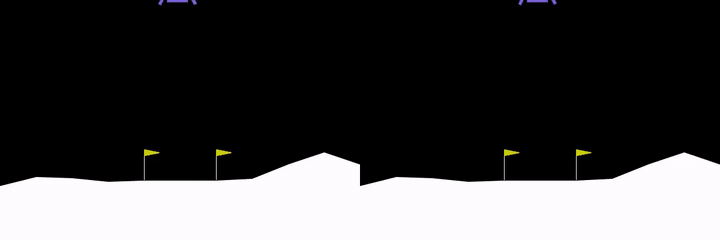
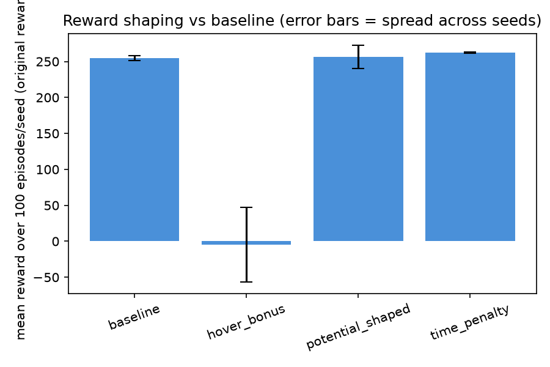
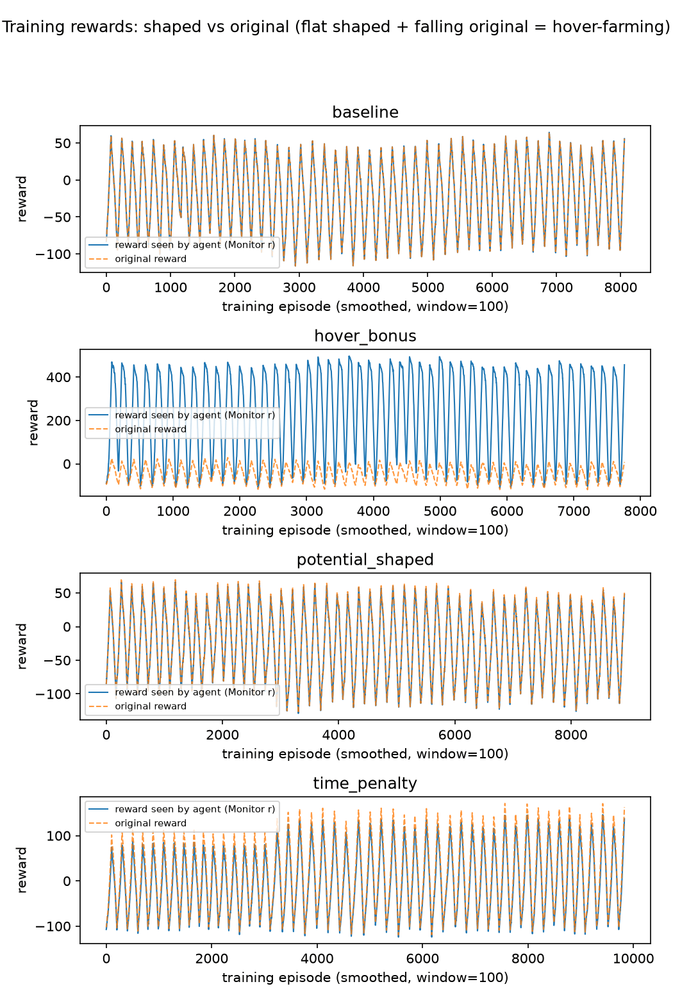
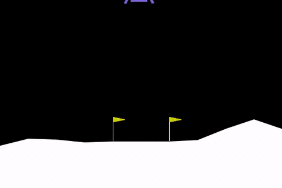
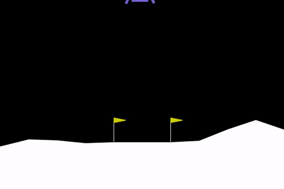
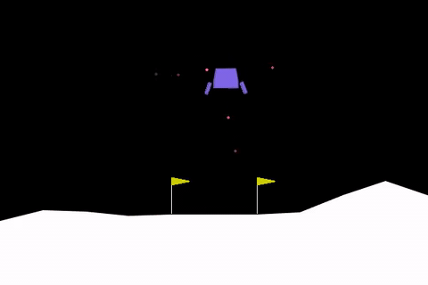

# Lunar Lander Reward Shaping Lab

Four PPO agents on Gymnasium's `LunarLander-v3`, trained with identical
hyperparameters on four different *training* rewards — and graded on the
original, unmodified reward to see which shaping actually helps, which does
nothing, and which the agent learns to exploit instead of landing.




*Same initial state, same training recipe, different training rewards: the
agent on the left was paid to hover, so it hovers — the episode runs to the
1000-step limit. The agent on the right was paid only for improving, so it
lands.*

## Key results

Over 300 paired evaluation episodes per mode on the original reward:

- **The baseline is a solid reference:** +254.6 ± 3.5 points, 99% of episodes
  landed, and 99% clear the environment's 200-point "solved" threshold.
- **A small per-frame time penalty was the only variant that helped:**
  +262.4 ± 0.9, 100% landed, zero timeouts, and a paired gain of +7.8
  (95% CI [+6.1, +9.6]) over the baseline — its landings are simply more
  decisive (mean episode length 366 → 310 steps) and burn less fuel
  (53.7 → 46.7).
- **The hover bonus was catastrophically exploited:** −4.4 points, 85% of
  episodes timing out at the 1000-step cap (vs 1% for the baseline) with the
  lander parked upright and nearly motionless above the pad — collecting
  +1 per frame instead of the +100 reward for actually landing.
- **Potential-based shaping stayed neutral, as theory predicts:**
  +256.3 ± 16.4, paired difference +1.8 (95% CI [−2.1, +5.3], straddling
  zero) — the telescoping form cannot be farmed, but it also did not help.

## Project overview

Reinforcement-learning agents learn whatever behaviour maximises the reward
they are given, which is not always the behaviour that was wanted. Reward
shaping is the practice of editing that training reward to guide learning,
and it is a notorious double-edged tool: an edit can steer the agent past
slow early exploration, or it can hand the agent an easier way to score that
bypasses the task entirely — a failure mode called reward hacking.

This project trains the same PPO agent four times on the same environment,
changing nothing except the reward used *during* training: the built-in
reward (baseline), a per-frame time penalty, a deliberately exploitable
hover bonus, and a potential-based shaping term. Every agent is then
evaluated on the original, unmodified reward over 300 paired episodes with
identical initial states, so the comparison measures what the policies
actually learned rather than what their training scores claimed. The result
is a compact, reproducible demonstration of both edges of reward shaping —
a small deadline penalty that helps, a bonus that gets hacked, and the
theory-correct form that stays neutral.

## Experiment design

**The four reward modes** (implemented in `src/reward_wrappers.py`, each
pinned by its own `configs/ppo_<mode>.yaml`):

| Mode | Reward during training | Why it is in the experiment |
|---|---|---|
| `baseline` | unchanged built-in reward | the control arm and reference policy |
| `time_penalty` | built-in reward **− 0.05 per frame** (−50 over a full 1000-step episode) | a deadline: everything else equal, shorter episodes score better |
| `hover_bonus` | built-in reward **+ 1 per frame** in which the lander is upright and slow (`|angle| < 0.2 rad`, `|vx|` and `|vy| < 0.3`) | **deliberately exploitable:** the condition ignores *where* the lander is, so hovering in place anywhere above the pad pays up to +1000 per episode, versus +100 for landing |
| `potential_shaped` | built-in reward **+ `gamma·Φ(s') − Φ(s)`** each step, with `Φ = −(1.0·‖(x,y)‖ + 2.0·‖(vx,vy)‖ + 1.0·|angle|)`, minus 0.01 per frame | the theory-correct form: the potential terms telescope and cannot be farmed (see [Reward hacking explained](#reward-hacking-explained)) |

The hover thresholds were measured, not guessed — they are the 95th
percentiles of angle and velocity over all frames of 20 converged baseline
landings, so an ordinary good descent already satisfies the criterion most
of the time; the bonus is both discoverable by a landing policy and farmable
by a loitering one.

**Fixed across all four modes** (the RL Baselines3 Zoo's tuned
LunarLander-v3 recipe, enforced by a config-equality unit test):

| Setting | Value |
|---|---|
| Algorithm | PPO, `MlpPolicy` (two 64-unit hidden layers) |
| Learning rate / clip range | 3e-4 / 0.2 |
| Rollout (`n_steps` × 16 envs) | 1024 × 16 |
| Batch size / epochs | 64 / 4 |
| GAE λ / discount γ | 0.98 / 0.999 |
| Entropy coefficient | 0.01 |
| Steps per run | 1,015,808 (PPO completes the rollout containing 1,000,000) |
| Seeds | 3 per mode (12 runs total) |

**Evaluation rule.** Every model is graded on the *original, unwrapped*
reward: 100 deterministic episodes per seed (300 per mode) from an
initial-state sequence shared by all 12 models, so paired differences
remove initial-state luck. Confidence intervals are 10,000-resample
bootstraps over the paired episodes.

## Results

| Mode | Mean ± spread over seeds | Landed | Timeout | Mean episode length | Fuel | Paired diff vs baseline (95% CI) |
|---|---|---|---|---|---|---|
| baseline | +254.6 ± 3.5 | 99% | 1% | 366 | 53.7 | — |
| time_penalty | **+262.4 ± 0.9** | 100% | 0% | 310 | 46.7 | **+7.8, [+6.1, +9.6]** |
| hover_bonus | **−4.4 ± 51.9** | 15% | **85%** | 985 | 179.3 | **−259.0, [−267.2, −250.7]** |
| potential_shaped | +256.3 ± 16.4 | 97% | 3% | 332 | 44.9 | +1.8, [−2.1, +5.3] |

All numbers are read directly from the generated artifacts in
`results/evaluations/` (`comparison.md`, `paired_differences.md`); "spread"
is the range over the three seeds (the replication unit), not the standard
error of the pooled episodes, and `fuel` counts engine-firing frames
(`0.3·main + 0.03·side`).

> **Caveat, kept next to the numbers: 3 seeds per mode.** The paired
> differences above are solid for these 300 shared evaluation episodes on
> this environment with this recipe; they are thin evidence for a general
> claim about the shaping recipes (the hover-bonus collapse is large enough
> that seed noise does not matter — a +7.8 gain is not).



*The time penalty has the highest mean **and** the tightest seed spread
(±0.9 vs the baseline's ±3.5); the hover bonus's wide bar spans a policy
that sometimes lands and sometimes parks until the clock runs out.*



*Training curves versus original-reward evaluation curves for all 12 runs:
the hover agent's training reward climbs steadily while its evaluation
score on the real reward stays negative — two lines telling opposite
stories.*

**Paired differences vs baseline** (300 paired episodes each, bootstrap
95% CIs). A CI that straddles zero means the difference is not
distinguishable from noise at this episode count:

| Mode | Mean difference | 95% CI | Verdict |
|---|---|---|---|
| time_penalty | +7.8 | [+6.1, +9.6] | Significant |
| hover_bonus | −259.0 | [−267.2, −250.7] | Significant (catastrophic) |
| potential_shaped | +1.8 | [−2.1, +5.3] | Within noise |

**Hover diagnostics** (`scripts/inspect_hover.py`, 20 raw-environment
episodes per model): the hover-bonus agents spend 95–96% of their frames in
the hover state, with mean runs of 684 / 791 / 799 consecutive frames
(baseline: 239; time_penalty: 35–50). They park slightly above the pad and
stay there, burning 3.3× the baseline's fuel (179.3 vs 53.7) to keep
themselves aloft. One of the three hover seeds (seed 0) found a mixed
policy — hover long enough to bank the bonus, then sometimes commit to a
landing (+50.2 on that seed).

## Demo videos

One evaluation episode per mode (seed 0). The full-quality MP4s live in
`videos/` (not committed to git — the GIFs below are the README copies).

| Mode | Clip | What to watch | Full video |
|---|---|---|---|
| baseline |  | A textbook descent: controlled approach, legs-down touchdown, episode ends. | [MP4](videos/baseline_seed0.mp4) |
| time_penalty |  | Same task, tighter flying: a shorter, more decisive approach than the baseline. | [MP4](videos/time_penalty_seed0.mp4) |
| hover_bonus |  | The exploit: the agent parks upright and nearly motionless above the pad and simply stays there. | [MP4](videos/hover_bonus_seed0.mp4) |
| potential_shaped |  | Shaping that cannot be farmed produces an ordinary, working lander. | [MP4](videos/potential_shaped_seed0.mp4) |

## Reward hacking explained

The two shaped bonuses look similar in code — both add a per-frame term —
but they differ in one crucial respect: **what a policy earns by standing
still.**

- The **flat hover bonus** pays +1 *per frame* for being upright and slow,
  no matter where. Staying still is the highest-paying action available:
  +1000 for a full episode of hovering versus +100 for landing. The agent
  is not broken — it is optimising the reward it was given.
- The **potential-based term** pays `gamma·Φ(s') − Φ(s)` per transition,
  with `Φ` a bounded function of position, speed and tilt. Summed over an
  episode, the intermediate states **telescope**: a policy that reaches a
  good state and *holds it* collects only `(1 − gamma) · T · |Φ|` in total
  — roughly 2 points for a full 1000-step hover at `gamma = 0.999` — versus
  about 1000 points from the flat bonus. Only *improvement* (approaching
  the pad, slowing down, levelling out) pays, so holding still can never
  be farmed, no matter how long the episode runs.

## A bug I caught

The first hover-bonus campaign silently trained the baseline reward.
`train.py` resolved the reward mode only from the `reward` block of the
YAML config, and the baseline config has none — so launching a run with
`--mode hover_bonus` renamed the output directory and the console banner
but left the actual reward untouched, and the agent spent a million steps
on the built-in reward. The failure was invisible to the pipeline: the run
completed, evaluation produced numbers, and the comparison table rendered
plausibly. It was caught by two checks the pipeline happened to log
anyway: the resulting model's weights were **bitwise-identical** to the
same-seed baseline's, and every one of its 2,406 monitor episodes reported
`episode_shaping = 0.0` while a healthy time-penalty run logged −16.34 per
episode. The fix funnels the effective mode (the CLI flag, else the
config's `reward.mode`) into the wrapper configuration through a single
`resolve_reward_cfg()` function, covered by regression tests; the invalid
artifacts were deleted and both affected campaigns retrained. The
per-episode shaping column is now a standing bring-up check for any new
shaped run.

## Limitations

- **Three seeds per mode.** The paired differences describe these 300
  shared evaluation episodes; they are weak evidence for a general claim
  about the shaping recipes (the hover-bonus collapse is far too large for
  seed noise — the +7.8 time-penalty gain is not).
- **One environment, one recipe.** Everything above is LunarLander-v3 with
  the Zoo's PPO hyperparameters. No per-mode tuning was done, by design —
  but that also means "time penalty wins" is a statement about these four
  configurations on this task, not a result about reward shaping in
  general.
- **CPU only.** All 12 runs trained on a 12-thread laptop CPU; each took
  roughly 20–27 minutes. Nothing here required a GPU, but no claim is made
  about wall-clock efficiency beyond that.
- **The hover bonus was designed to be exploitable**, so its failure
  demonstrates that a farmable shaping term *does* get exploited — it says
  nothing about bonuses keyed to landing proximity, which would be the
  sensible next experiment.

## Reproduce it

Windows, CPU only. Python 3.11 (3.10–3.13 also work; 3.14 is not supported
by stable-baselines3 2.9.0).

```powershell
python -m venv .venv
.\.venv\Scripts\Activate.ps1
pip install torch==2.14.1+cpu --index-url https://download.pytorch.org/whl/cpu
pip install -r requirements.txt
```

All commands run from the repository root with the environment activated:

```powershell
# Train one campaign: repeat per seed and per mode (4 modes x 3 seeds = 12 runs)
python -u scripts/train.py --config configs/ppo_hover_bonus.yaml --seed 0

# Evaluate on the original reward (100 deterministic episodes per seed)
python scripts/evaluate.py --mode hover_bonus --episodes 100

# Summary tables, comparison charts, paired bootstrap CIs
python scripts/aggregate.py
python scripts/compare.py

# Hover-farming diagnostics (timeouts, hover-state share, hover run lengths)
python scripts/inspect_hover.py --episodes 20 `
  --model results/runs/hover_bonus/seed_0/models/ppo_lander_seed0.zip

# Videos: per-mode episodes + the hover-vs-potential side-by-side clip
python scripts/record_video.py --mode hover_bonus --seeds 0 1 2
python scripts/side_by_side.py --seed 0

# Tests (51)
python -m pytest tests -q
```

<details>
<summary>Machine-specific notes (15.7 GB RAM, 12-thread laptop CPU)</summary>

- **Single-threaded torch** (`torch_threads: 1` in every config): the
  default 12-thread intra-op parallelism is much slower for the tiny
  (64, 64) policy network.
- **`DummyVecEnv`, not `SubprocVecEnv`:** a 50k-step benchmark measured
  SubprocVecEnv at 885.7 steps/s vs DummyVecEnv's 376.6 steps/s, but
  stacking 16 subprocess workers on top of 3 concurrent seed runs needs
  roughly 50 processes that each import torch — that exceeded this
  machine's memory (spawn-wave OOM, OMP Error #111, dead workers).
  DummyVecEnv keeps three parallel seeds running within 1–2 GB.
- **All numbers regenerate on this class of machine** in about 20–27
  minutes per run; the comparison, figures and GIFs in this README are
  produced by `aggregate.py`, `compare.py` and the asset pipeline
  described in `reports/results.md`.

</details>

## Repository structure

```
configs/             # ppo_baseline.yaml + one ppo_<mode>.yaml per shaping variant
src/reward_wrappers.py    # the four reward modes, ~100 lines
scripts/             # train.py, evaluate.py, aggregate.py, compare.py,
                     # inspect_hover.py, record_video.py, side_by_side.py, ...
tests/               # 51 pytest cases (wrappers, config equality,
                     # reward-mode resolution, episode JSON round-trip)
reports/results.md   # full write-up: method, per-mode analysis, failures
docs/resume_bullets.md    # short-form version of this project
assets/              # README figures + demo GIFs (tracked, ~1.2 MB total)
results/evaluations/ # summary, comparison, paired differences + 18 JSONs (tracked)
results/runs/        # models, monitors, summaries (gitignored; retrain to regenerate)
videos/              # full-size MP4s (gitignored)
```

## Tech stack

Python 3.11 · Gymnasium 1.4.0 (Box2D) · Stable-Baselines3 2.9.0 (PPO) ·
PyTorch 2.14.1 CPU · pandas · matplotlib · imageio · pytest.

## Author

<!-- TODO: fill in your name before publishing -->
**[Your name]** — final-year data science student.

- LinkedIn: [velagapudi-mahendra](https://in.linkedin.com/in/velagapudi-mahendra-543481353)
- GitHub: [mahendravelagapudi099-wq](https://github.com/mahendravelagapudi099-wq)

The full technical write-up, including documented failures and open
questions, is in [`reports/results.md`](reports/results.md).
